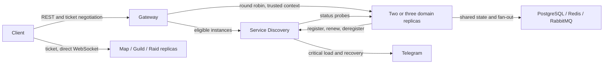

# Lab 3: discovery, scaling and failure contract

Status: **proposal for team review**, tracked by CPR #119. Telegram is the owner's selected
notification channel. All other new defaults below require confirmation by all four owners
before dependent implementation PRs merge. The released Lab 2 stack remains documented in README.

## Scope and topology

Eight domain services keep their existing state ownership and REST/event schemas. Service
Discovery (SD, JavaScript) owns only the registry and health/failure observations. Gateway keeps
client authentication, trusted context, request limits and deadlines. Domain REST calls still
pass through Gateway; registration, probes and failure reports are internal control-plane calls.
The Lab 3 baseline has two replicas per domain service, one Gateway and one SD. Three replicas
must also work. Scaling Gateway/SD themselves requires a separate key/registry coordination design.



SD listens internally on port 8090 (`DISCOVERY_URL=http://service-discovery:8090`). It has no
client-facing Gateway slug and no host port. Its internal APIs require `X-Service-Token` with
the existing `SERVICE_TOKEN` and `X-Correlation-Id`; comparisons are constant-time. Invalid
credentials return `401 UNAUTHORIZED`. No user JWT or trusted user headers authorize SD calls.
Use TLS outside the local isolated Compose network. Secrets never appear in registry responses.

## Identity and registration

The eight service names are the existing Gateway slugs. Gateway and SD expose status/logs too,
but are not registered as routable domain targets. Each domain process generates a new UUID v4
`instanceId` on startup and keeps it until exit. Restart means a new ID. SD derives timestamps
and lease expiry from its own clock; clients cannot extend a lease by submitting timestamps.

```http
POST /api/v1/internal/discovery/instances
X-Service-Token: <service-token>
Content-Type: application/json
```

```json
{
  "service": "map",
  "instanceId": "9f1c2b7e-3b2a-4c1d-9f31-2a7c5d0e4b11",
  "baseUrl": "http://map-1:8085",
  "statusPath": "/api/v1/status",
  "wsPublicUrl": "ws://localhost:18085",
  "version": "3.0.0",
  "taskTimeoutMs": 3000
}
```

`baseUrl` and optional `wsPublicUrl` are origins without userinfo, query, fragment or path.
WebSocket URL is required only for Map/Guild/Raid. Addresses must match deployment-configured
host/port allowlists per service; SD rejects loopback/internal metadata destinations outside
that allowlist. Registration does not permit arbitrary probe destinations. Instance IDs are
globally unique; reusing an ID for a different service/address returns `409 INSTANCE_CONFLICT`.
All numeric configuration values must be positive integers; version is SemVer.

| Method and internal SD path | Successful response | Behavior |
| --- | --- | --- |
| `POST /api/v1/internal/discovery/instances` | `201` new, `200` identical repeat | Register as `pending`; return instance record |
| `PUT /api/v1/internal/discovery/instances/{instanceId}/lease` | `200` instance record | Renew existing active registration; never create/reactivate it |
| `GET /api/v1/internal/discovery/services/{service}/instances` | `200 { "instances": [], "generatedAt": "..." }` | Only unexpired, ready, non-removed instances; sorted by ID |
| `DELETE /api/v1/internal/discovery/instances/{instanceId}` | `204` | Idempotent shutdown removal, including unknown/already removed ID |
| `POST /api/v1/internal/discovery/failures` | `202 { "removed": false }` | Record deduplicated actual upstream attempt; see breaker rules |

An instance record contains the registration fields plus `state` (`pending`, `ready`, `unready`,
`removed`), `registeredAt`, `leaseExpiresAt`, `lastCheckedAt` (nullable), and `removedAt` (nullable),
all UTC timestamps. A lease response contains no credentials. Invalid fields return
`400 VALIDATION_FAILED`; unknown service `404 SERVICE_NOT_FOUND`; unknown/expired lease
`404 INSTANCE_NOT_FOUND`; removed instance renewal `409 INSTANCE_REMOVED`. All failures use
README's common error envelope, timestamp and correlation ID.

Proposed timings: renew every 10 s, lease TTL 30 s, probe every 5 s with 1 s timeout; run the first
probe immediately after registration. SD marks ready only after a successful readiness probe.
A failed/not-ready probe excludes the instance immediately; the next successful probe restores
it if its lease is valid and it has not been removed by a breaker. Expired leases disappear from
lookup regardless of background cleanup. Repeated registration of a removed ID cannot revive it.

On startup, a service serves status but does not become routable until registration/probe succeeds.
It retries SD registration with bounded exponential backoff (1 s to 10 s, with jitter). Following
SD restart/unknown lease, it registers again. SD may keep this ephemeral registry in memory;
loss of SD state is recovered by re-registration, never by trusting stale Gateway targets.
On SIGTERM, mark not ready, deregister, drain in-flight work up to the configured shutdown deadline,
then exit; SIGKILL is handled by probes and lease expiry. Removed IDs remain tombstoned for the
SD process lifetime. A deliberate restart with a fresh ID may rejoin only after a healthy probe.

## Common status and load

Every domain replica, Gateway and SD implements `GET /api/v1/status`, accessible on the internal
network without user authentication. Existing `/health` or `/healthz` paths remain compatible.
Status routes bypass application concurrency admission so they can report saturation. They do
not disclose URLs, credentials, database errors or user data.

```json
{
  "service": "map",
  "instanceId": "9f1c2b7e-3b2a-4c1d-9f31-2a7c5d0e4b11",
  "version": "3.0.0",
  "live": true,
  "ready": true,
  "load": { "activeTasks": 8, "maxTasks": 10, "ratio": 0.8 },
  "timestamp": "2026-10-28T12:00:00.000Z"
}
```

Return `200` when live and ready; `503` otherwise, using the same status payload (an explicit
exception to the common error envelope). Liveness means the process can answer; readiness means
required local dependencies and initialization are usable, including registration for domain
replicas. SD startup probes must not recursively depend on Gateway or remote domain services.
Compute `ratio = activeTasks / maxTasks`; count domain tasks, Gateway HTTP in-flight requests and
SD's bounded control tasks respectively. An idle WebSocket is not an active task. Probe handlers
must use cached/bounded local dependency checks and must not recursively call other status routes.
SD and Gateway need only process/config/local-state readiness, not a recursive readiness graph.

SD emits `load.critical` after two consecutive successful polls with ratio >= 0.8; it emits
`load.recovered` after two polls below 0.6. Between thresholds preserve prior alert state.
Timeout/malformed status is a health failure, not a zero-load measurement. Publish/log health
failure and recovery separately, once per transition. High load alone does not remove a ready
replica: the existing admission limit continues to return `429` with `Retry-After`.

## Gateway lookup and round robin

In Lab 3 `DISCOVERY_URL` replaces the eight static target URLs as Gateway's routing authority.
Do not silently fall back to old targets. Cache each service's eligible list for at most 1 s.
If SD cannot refresh an expired cache, fail closed with `503 DEPENDENCY_UNAVAILABLE`; an empty
eligible list gives `503 SERVICE_UNAVAILABLE` and `Retry-After: 1`. SD calls have a bounded
1 s timeout within the existing request deadline. Deadline exhaustion still returns `504`.

For each service keep the last selected instance ID; choose its next sorted successor, wrapping
to the first. A removed last-selected ID uses the next greater eligible ID, or first. This is
deterministic under joins/removals and avoids a shared counter across unrelated services. Selection
and advancement are atomic within the single Gateway process. Snapshot membership once per
request; let dispatched requests finish/cancel normally rather than switching them to another
replica mid-request. Never automatically retry a state-changing command.

Gateway's direct User Management JWKS bootstrap and ticket eligibility lookups also select an
instance from SD. All existing trusted-context, internal-route restrictions, correlation IDs,
deadlines and limits remain mandatory. Internal responses include Gateway-generated
`X-Upstream-Instance-Id`, `X-Upstream-Attempt-Id` (UUID) and `X-Upstream-Task-Timeout-Ms`.
Gateway strips spoofed copies from clients/upstreams; it strips these control headers from
public responses and exposes them only to authenticated service callers for failure accounting.

## Circuit breakers and removal

Every service that calls another service, including Gateway, implements a breaker for every
outgoing endpoint. Use the HTTP method plus registered route template (for example
`GET /api/v1/internal/raids/{raidId}/participants/{userId}`), never raw resource IDs or query strings.
Gateway maintains per-target-instance/per-endpoint state; callers through Gateway maintain
per-logical-service/per-endpoint state and use returned instance metadata when it exists.

The window is `ceil(target.taskTimeoutMs * 3.5)` milliseconds. This is the target's advertised
local task timeout, not the caller's remaining end-to-end deadline. A 3000 ms target gives 10500 ms.
Use monotonic elapsed time in local counters. On each actual failure discard samples older than
the window, append the current sample, and trip on the third. Success does not erase still-in-window
failures. Count connection failures, target-side timeouts and actual upstream HTTP 500/502/503/504.
Do not count business 4xx, admission 429, caller cancellation, local validation/auth errors,
or synthetic circuit-open/no-instance responses. A target-generated `503 TASK_TIMEOUT` counts;
an earlier caller deadline alone does not prove the target failed.

At Grade 7, trip logs `circuit.open` and rejects further calls to that endpoint for one window.
After cooldown permit one half-open trial; success closes and clears the counter; failure opens
again for a window. Synthetic rejections use `503 DEPENDENCY_UNAVAILABLE`, `Retry-After`, and
do not become new failure samples. Other endpoints retain independent counters.

At Grade 10 keep the local breaker and additionally remove the implicated target instance from
discovery once the three-error threshold is reached. Gateway reports each actual attempt directly
to SD. A service caller may report the same attempt using Gateway response metadata; SD deduplicates
by `attemptId`, preventing one physical failure from being counted twice. Reports expire from
dedup storage after at least the maximum breaker window. Reports without an attributable target
cannot remove anything: log/open the logical caller breaker and let Gateway account for the
physical attempt. SD probe failures affect readiness independently and are not endpoint samples.

```json
{
  "service": "monster-raid",
  "instanceId": "9f1c2b7e-3b2a-4c1d-9f31-2a7c5d0e4b11",
  "attemptId": "0b5f2a91-6d3c-4e8a-b0d2-9a1f7c4e6b33",
  "endpoint": "GET /api/v1/raids/{raidId}",
  "failure": "UPSTREAM_TIMEOUT"
}
```

Allowed failures: `CONNECTION_FAILED`, `UPSTREAM_TIMEOUT`, `UPSTREAM_5XX`. SD accepts only known
instances and agreed route templates; unknown IDs return `404 INSTANCE_NOT_FOUND`. SD uses its
own receipt time and registered timeout. For the single-Gateway baseline, Gateway sends each
report before a subsequent attempt to that same instance; a failed report is logged and queued
with the same attempt ID for bounded retry. SD applies the threshold atomically and returns
`202 { "removed": true }` when this report caused removal. Gateway immediately evicts a locally
tripped target and invalidates its service cache. A failed report cannot keep routing to a known
failed instance. Removal only affects that ID, not the whole service. Recovery requires an
operator restart/new ID and a successful probe; a heartbeat cannot silently undo quarantine.

## Direct WebSockets and state across replicas

Gateway chooses a ready Map/Guild/Raid replica during ticket negotiation and builds the direct URL
from that record's deployment-allowlisted `wsPublicUrl`, appending the existing channel path and
ticket. Clients never supply the target origin. Keep the current RS256 claims and <= 60 s expiry;
all replicas fetch the single Gateway's JWKS. Guild's one-use `jti` must be consumed atomically in
shared storage across replicas. Expiry does not terminate an already-open connection.

For local Compose expose distinct host ports for each live replica, e.g. map-1 `18085:8085`,
map-2 `28085:8085`; Guild/Raid use distinct corresponding ports. Register those explicit public
origins. Use explicit replica blocks or equivalent per-instance configuration so each process
advertises its own correct URL; a shared host port cannot identify a replica. Non-live replicas
and stores remain private. SD registration uses internal URLs, never localhost URLs for probes.
On disconnect get a new ticket from Gateway and resynchronize from a fresh snapshot/history.
Removal stops new admissions but does not migrate an existing socket to another process.

No correctness-critical state may exist solely in a process-local map. Use each service's own
PostgreSQL/Redis state and cross-replica fan-out with its existing broker. Map must share locations,
proximity dedup and stream updates; Guild must share chat history/fan-out and replay protection;
Raid must share HP, feed events, timers and the atomic terminal/reward claim; Battle must share
turn/idempotency state. Event consumers use durable competing-consumer queues and persistent
deduplication. Do not create extra reward/notification copies merely by adding a replica.

## Logs and Telegram

Emit one JSON object per line to stdout/stderr. Required fields: UTC `time`, `level`, `service`,
`instanceId`, `event`, `message`; include `correlationId` for requests/events and `method`, sanitized
route template, `status`, `durationMs`, `targetService`, `targetInstanceId`, `attemptId` when relevant.
Log startup/shutdown, registration/lease, probes/transitions, request completion, breaker transitions,
removal and notification outcomes. Never log JWTs/tickets, passwords, service tokens, Telegram bot
token, device tokens, raw request bodies or query strings. Error details must be redacted too.

SD sends Telegram for critical load, load recovery and health failure/recovery. Alert fields:
`eventId` UUID, `service`, `instanceId`, `type`, `severity`, `observedAt`, measured ratio if available.
Deduplicate by event ID. Default delivery timeout 3 s, three attempts with backoff 1 s then 2 s,
respect provider Retry-After; bounded queue of 100 alerts and bounded outbound concurrency 1.
Log final failure/queue overflow; never block probes/registry on Telegram. A Telegram outage does
not make SD unready. Configure `TELEGRAM_BOT_TOKEN`, `TELEGRAM_CHAT_ID` as secrets only in SD;
configure `ALERTS_ENABLED=false` for local fake-provider tests. Alert delivery is at least once:
duplicates after ambiguous provider timeouts remain possible and carry the same event ID.

## Review gates and rollout evidence

These proposed defaults, endpoints, failure semantics and topology need written confirmation in
the #119 PR by Nickseen, Vlad, Gabi and Cristi. The contributor-policy minimum of one dev approval
does not replace that issue-specific gate. Code can be drafted against mocks; dependent changes
must not merge until the contract is accepted. This document does not claim deployed support.

1. Agree this contract and bootstrap SD (#120); each contributor owns a separate SD part
   (#121 health, #122 Telegram, #123 removal).
2. Implement and release domain services (#124-#131) and Gateway (#132) using fake SD/dependencies
   where necessary; use meaningful tests and >= 80% service line coverage.
3. Compose integration (#133) demonstrates two replicas of all eight services, then scales one to
   three; inject failures, observe round robin, registry eviction and actual Telegram alerts.
4. Verify all Grade 2-10 requirements in #134; publish reviewed 3.x.y service releases, pin image
   versions/submodule commits and validate README/Postman. CPR release follows integration.

Required evidence includes: lease expiry during SIGKILL; SD/Gateway restart; empty lookup and
expired cache; join/remove during requests; 2 failures versus 3 failures within/outside the window;
deduplicated attempt reports; healthy sibling availability; removed-ID renewal rejection;
cross-replica WebSocket delivery; one reward/ownership/notification effect; alert hysteresis,
provider outage and redaction. Exact threshold tests use a controllable clock, not long sleeps.
